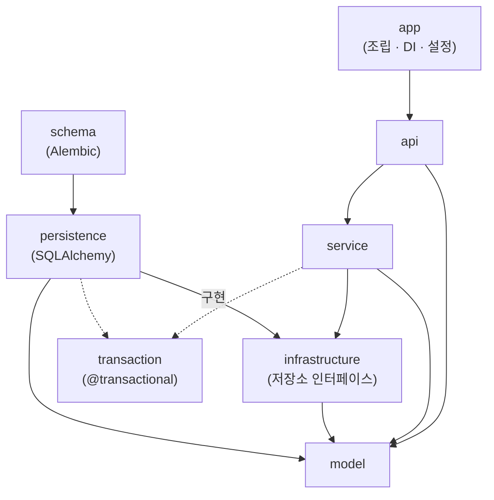
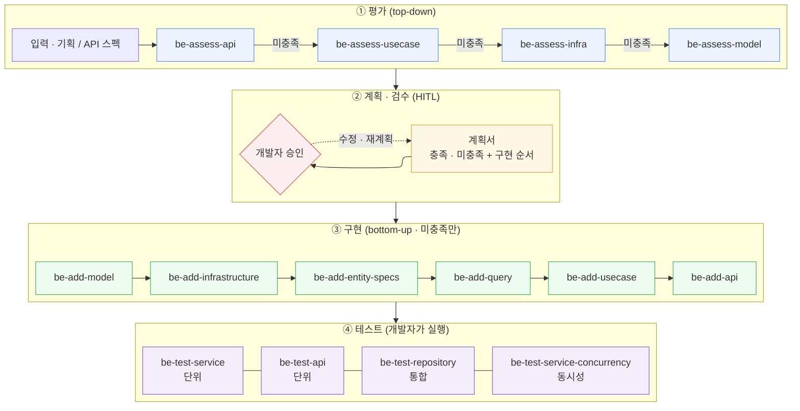

# dk-py-bundle

LLM 으로 백엔드를 만들 때 코드 퀄리티의 저점을 높이고, 결과를 예측 가능하게 만드는 Claude Code 스킬 모음입니다.
FastAPI + SQLAlchemy 2.0 + uv workspace 기반이며, Java/Spring 버전 [dk-be-bundle](https://github.com/ai-setup-share/dk-be-bundle) 을 Python 으로 옮긴 것입니다.

## 코드 퀄리티의 기준

### 파악이 쉽다
- 정해진 위치에 정해진 소스가 있다.
- 클래스와 파일 하나는 역할 하나를 맡는다.
- 모듈과 파일의 역할을 정했으면 그 모양을 의도적으로 다양하게 두지 않는다. 구조 자체가 의미를 드러낸다.

### 테스트할 수 있다
- 모듈은 밖으로 노출할 인터페이스를 정하고, 그 인터페이스를 mock 해서 단위 테스트할 수 있다.
- 모듈 단위 테스트를 마치면 유저 시나리오 단위의 통합 테스트로 이어갈 수 있다.

## 접근 방식

1. 표현력이 좋은 백엔드 모듈 구조를 하나 정한다. flex 백엔드 아키텍처 세션에서 발표된 모듈 구조를 참고했다.
2. 그 구조의 요소마다 평가 스킬과 제작 스킬을 만든다.
3. planner 스킬이 기획 단위 요청을 받아, 어떤 요소를 얼마나 쓸지, 기존 코드와 API 를 고칠지 추가할지를 판단하고 제작 스킬을 호출한다.
4. 제작이 끝나면 개발자가 테스트 스킬을 실행한다.

## 모듈 구조



| 패키지 | 담는 것 |
|---|---|
| `model` · `exception` | 불변 도메인 모델, 도메인 예외. 외부 의존 없음 |
| `infrastructure` | Repository 인터페이스(ABC). service 는 이것만 안다 |
| `persistence` | Entity, `{Domain}EntityQuery`(같은 aggregate), `{Domain}JoinQuery`(SQL JOIN), `Default{Domain}Repository`(구현체) |
| `service` | Reader(조회) · Writer(명령) · Usecase(조합) |
| `api` | 라우터, 요청 · 응답 DTO |
| `schema` | Alembic migration |
| `transaction` · `my_logging` | 트랜잭션 계약, JSON 로깅과 요청 컨텍스트 |
| `app` | FastAPI 조립, dishka DI, 설정, 미들웨어 |

의존 방향은 import-linter 계약이 검사합니다. 예를 들어 service 가 persistence 나 sqlalchemy 를 import 하면 검증에서 실패합니다.

## 작업 흐름



## 스킬 목록

| 구분 | 스킬 | 하는 일 |
|---|---|---|
| 시작 | `be-init` | 빈 uv workspace 생성. 10개 패키지, DI 컨테이너, 트랜잭션 계약, 로깅, 예외, Alembic, 테스트 픽스처. 한 번만 실행 |
| 오케스트레이션 | `be-planner` | 요청 하나를 받아 평가 → 계획서 → 개발자 승인 → 필요한 제작 스킬만 순서대로 호출 |
| 평가 | `be-assess-api` · `-usecase` · `-infra` · `-model` | 각 층이 요청을 이미 처리할 수 있는지 판정하고, 아래 층에 필요한 것을 도출 |
| 제작 | `be-add-model` | 도메인 모델 · Identity · 도메인 예외 |
| | `be-add-infrastructure` | Repository 인터페이스 |
| | `be-add-entity-specs` | Entity + Alembic migration |
| | `be-add-query` | Repository 구현체 + EntityQuery + JoinQuery |
| | `be-add-usecase` | Reader · Writer · Usecase + DI 등록 |
| | `be-add-api` | 라우터 · DTO + 라우터 등록 |
| 테스트 | `be-test-service` | service 단위 테스트 (mock, DB 없음) |
| | `be-test-api` | 라우터 단위 테스트 (mock, DB 없음) |
| | `be-test-repository` | 저장소 · SQL 통합 테스트 (testcontainers Postgres) |
| | `be-test-service-concurrency` | 동시 요청 통합 테스트 (스레드 + 실제 커밋) |

## 이 번들이 해결하지 않는 것

- 데이터 모델링과 테이블 설계. LLM 에게 추천은 받을 수 있지만, 전체 계획에 맞는지는 개발자가 직접 검수하기를 권합니다. planner 에 넘기기 전에 테이블 설계를 정해 두면 결과가 안정됩니다.
- 검색 · 인증 · 챗봇 같은 "엔진" 성격의 기능. 전문성이 필요하거나 일반적이지 않은 기능은 별도 모듈을 만든 뒤, 그 모듈 안에서 Claude Code 와 따로 대화하며 작업하기를 권합니다.

## 설치와 사용

```bash
# 이 저장소를 플러그인으로 지정해 실행
claude --plugin-dir /path/to/dk-py-bundle

# 또는 설치
claude plugin install /path/to/dk-py-bundle --scope user
```

```text
/dk-py-bundle:be-init                          # 빈 디렉터리에서 한 번
/dk-py-bundle:be-planner "POST /api/articles"  # 기획 / API 스펙 단위로 반복
/dk-py-bundle:be-test-service ArticleCreateUsecase
```

## 기술 스택

Python 3.12 · uv workspace · FastAPI · SQLAlchemy 2.0 (`def` + `Session`, 동기 스레드 모델) · dishka · Alembic · PostgreSQL 16 · pytest + testcontainers · ruff · mypy · import-linter · structlog

## 검증

FE 핸드오프 문서 하나로 실제 서비스 백엔드(12개 도메인, API 36개)를 planner 자동 실행으로 만들어 확인했습니다. 12개 도메인 모두 정적 검사와 migration 검증을 통과했고, 이후 테스트 스킬로 단위 · 통합 · 동시성 · 시나리오 테스트 202개를 작성해 모두 통과했습니다.
